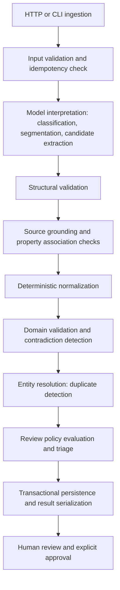

# Dwelleo — Listing Inbox Normalizer: Implementation Plan

Created: 2026-11-08 (Africa/Cairo).

Status: proposed implementation baseline, written before application implementation.

Source of requirements: [candidate brief](https://app.notion.com/p/Dwello-task-4121b4ca63c980d482cde22eedfff233) and the supplied architecture handoff. The candidate brief governs assessment requirements; the handoff records prior discussion. Proposed policies below require resolution before their affected feature is implemented.

Preserve this plan once implementation begins. Record subsequent decisions and deviations in `DECISIONS.md`, implementation evidence and session summaries in `AI_LOG.md`, and current setup and limitations in `README.md`.

## Planning references

This plan is the root of the planning structure. Its delivery details are refined in the following documents:

- [Success criteria](docs/success-criteria.md): brief-derived acceptance conditions and coverage evidence.
- [Roadmap](docs/roadmap.md): sequences delivery of this plan into phases.
- [Phase plans](docs/phase-plans/README.md): define each phase's outcomes, scope, and completion criteria.

The roadmap sequences delivery. Phase plans hold the tasks, testing tasks, and evidence.

## 1. Objective and scope

Build a small service that converts Saudi real estate broker messages into structured property records with traceable facts and explicit review reasons.

Required delivery:

- CLI: `process <input.jsonl>`, with one JSON result per message and diagnostics on stderr.
- HTTP: `POST /messages`, `GET /listings?needs_review=true|false`, and `POST /listings/:id/approve`.
- Embedded SQLite persistence, message classification, multiple-property extraction, deterministic normalization, property deduplication, and human-review triage.
- Tests that run without credentials, network access, or an installed model CLI.
- Reproducible setup, meaningful Git history, a preserved initial plan, decision records, agent-session evidence, and honest operational limitations.

The primary invariant is source fidelity: unsupported facts remain null. Model output is untrusted input, even when it satisfies a JSON Schema. Model-generated evidence must be verified against the original source and evaluated in the context of the correct property.

Defer the UI, reviewer assignment, standalone gateway deployment, second model-provider adapter, automatic provider fallback, local-model installation, and direct paid API integration. Keep extension points small enough to implement those later.

## 2. Known starting state

- The workspace contains no application source or package manifest. Its current `.git` directory is a read-only placeholder, and Git does not recognize it as a repository. Establish a usable Git repository before the implementation sequence; preserve the planning baseline as the first authorized commit. Do not replace the placeholder or create commits without appropriate access and authorization.
- WSL has Node.js 24.18.0 and npm 11.16.0. Package versions and compatibility still need verification at bootstrap.
- Antigravity CLI 1.5.3 is installed at `/home/sweetpotato/.local/bin/agy`; this agent session's PATH does not include that directory.
- A live authenticated call using `gemini-3.8-flash-low` successfully returned schema-constrained Arabic extraction, including a null city when none was provided.
- That single call reported 2.2 seconds, 7,065 input tokens, and 33 output tokens. These are smoke-test observations, not representative extraction accuracy, cost, or application latency measurements. No USD cost was reported.
- The agent sandbox blocks Antigravity's normal local sockets and profile logging; the smoke test required escalated execution. Installation alone does not establish whether an evaluator can run the provider.
- The smoke-test command warned that `--mode plan` has no effect with slash-command expansion disabled. It did not establish effective tool isolation. Verify actual restrictions before submitting untrusted broker messages.

## 3. Stack and module boundaries

Use TypeScript, NestJS, Prisma with SQLite, and Zod. Proposed tooling: Node.js 24 LTS, npm with a committed lockfile, and Jest with Nest's testing utilities. Confirm mutually compatible stable versions, including a Prisma release that supports SQLite, before installation. Resolve exact versions during bootstrap; avoid introducing another package manager solely for this assessment.

| Module | Responsibilities | Boundary |
| --- | --- | --- |
| `MessagesModule` | Input validation, message ingestion, processing orchestration, repeated-ingestion handling, message history, HTTP ingestion | Owns the shared `MessageProcessor` used by HTTP and CLI |
| `ExtractionModule` | Domain prompt, message classification, property segmentation, candidate assertions, extraction schema, source-evidence validation | Owns real estate interpretation and the intermediate extraction contract |
| `ListingsModule` | Fact normalization, contradiction detection, review policy, deduplication, listing persistence, queries, approval | Owns normalized listing behavior and persisted review state |
| `LlmGatewayModule` | Provider selection, subprocess execution, response-envelope parsing, timeout and output limits, execution metadata | Receives a generic schema and returns unknown output; contains no real estate rules |
| `DatabaseModule` | Prisma client, SQLite connection lifecycle, database access shared by feature modules | Supplies persistence infrastructure |

`AppModule` composes these modules. The CLI bootstraps a Nest application context and invokes the same processor as the HTTP controller without starting an HTTP listener.

Keep normalization, review policy, and duplicate detection as focused functions or services within `ListingsModule`. Add modules only when a concrete responsibility requires another boundary.

## 4. Processing model and terminology

This is an ingestion and validation pipeline. Validation is applied at several boundaries rather than being a single final check.

| Stage | Behavior and failure handling |
| --- | --- |
| Input validation | Validate ID, sender representation, timestamp, and text. Preserve original text. Check whether this message has already been processed. |
| Semantic interpretation | Use a single initial model call to classify the message, identify property boundaries, and extract assertions with evidence and uncertainty. |
| Structural validation | Parse the provider envelope and validate extraction output at runtime. Invalid output becomes a processing failure, not an invented listing or an `irrelevant` classification. |
| Source grounding | Check that quoted evidence exists in the original source. Check property scope and the claimed field meaning where deterministically possible. Reject unsupported assertions or mark uncertain associations for review. Substring matching alone does not establish semantic correctness. |
| Normalization | Convert supported raw expressions into canonical digits, phone numbers, prices, units, and labels while preserving their evidence and qualifiers. |
| Domain validation | Detect impossible or contradictory assertions and missing applicable fields. Preserve competing assertions; do not silently select a preferred price. |
| Entity resolution | Compare incoming normalized properties with persisted listings and relevant candidates from the same ingestion. Distinguish confirmed duplicates from uncertain similarities. |
| Review triage | Compute `needs_review` and readable, machine-readable reasons from all preceding findings. This is policy evaluation, not another model decision. |
| Persistence | Store message provenance, normalized listings, evidence, review findings, and duplicate references consistently. Keep model execution outside the database write transaction. |
| Human approval | Update persisted approval and active review state while retaining the original findings and an approval timestamp. |

Reviewer assignment means allocating work to a specific person or queue. The assessment requires review flagging and approval; it does not require reviewer assignment.

## 5. Contracts to establish before the processing implementation

Define and test these contracts before creating the domain tables and processing services:

1. `RawMessage`: the supplied ID, sender, received timestamp, and original text.
2. `ExtractionResult`: message classification, multiple property candidates, raw assertions, source quotes, property scope, and uncertainty. Multiple assertions for one field must remain representable.
3. `NormalizedListing`: the required marketplace fields, review reasons, duplicate reference, and internal provenance needed for validation.
4. `MessageResult`: the assessment's required success envelope. Buyer requests and irrelevant messages return an empty listings array.
5. `ProcessingFailure`: an explicit error representation for invalid input, missing provider, authentication failure, timeout, output overflow, and invalid extraction. Its CLI shape and HTTP mapping remain a contract decision.
6. `LlmRequest` and `LlmResponse`: generic provider-independent execution contracts.

The gateway request includes instructions, input, and a response JSON Schema. The response includes provider, selected or reported model, unknown output, available token counts, measured wall-clock latency, and nullable cost. Provider adapters map schema options and metadata without weakening application validation. Unavailable cost means unknown, not free.

Keep a Zod extraction schema as the application contract and derive a portable JSON Schema for model generation. Use a supported schema subset. Document any provider-specific restrictions or unsupported constraints.

### Open policy checkpoints

Resolve these in `DECISIONS.md` before the affected implementation. The directions here are proposals, not completed decisions.

| Decision | Proposed direction | Resolve before |
| --- | --- | --- |
| D-01: Runtime availability and failures | Require an installed, authenticated configured provider; reject unavailable execution explicitly. Preserve one CLI record per input message without fabricating a successful classification. Define malformed-line behavior and HTTP status mapping. | CLI/API processor |
| D-02: Area semantics | Retain land and built-up area separately internally. Define a documented projection to `area_sqm`; compare like area types during deduplication. | Normalization and persistence schema |
| D-03: Project representation | Classify off-plan developments as `project`; preserve starting-price qualifiers and bedroom ranges. Avoid representing a range as one exact unit attribute. Define how project candidates map to the minimum listing contract. | Extraction schema |
| D-04: Inference and source policy | Keep missing city null; avoid geographic guesses and a default sender-as-contact rule. Document any allowed semantic inference, such as rental purpose from an explicit rental period. | Evidence validation |
| D-05: Review policy | Define applicable required fields by property type and purpose. Missing bedrooms do not make land incomplete. Distinguish missing, unsupported, ambiguous, and conflicting assertions. | Review-policy implementation |
| D-06: Duplicate confidence | Use compatible location, type, purpose, comparable area, price, and independent identifying evidence. Strong matches populate `duplicate_of`; plausible matches require review. Different broker contacts do not automatically exclude a duplicate. | Duplicate detection |
| D-07: Replay and approval semantics | Same ID and same original payload should avoid another model call and another listing insertion; changed content under the same ID should be rejected. Define whether replay returns the original ingestion snapshot or current review state. | Persistence integration |
| D-08: Provider execution restrictions | Verify settings that prevent unnecessary tool use, file access, and workspace-instruction loading. Pin the model and limit runtime/output. A prompt instruction alone is not an isolation mechanism. | Real untrusted input |

Also document how the fixed SAR output field behaves when currency is omitted or a message explicitly uses another currency. Do not silently convert currencies or installment/down-payment amounts into asking prices.

## 6. Implementation sequence

The original assessment targets approximately five focused hours. Time already spent is not tracked exactly. The following is a 300-minute allocation for prioritization, not a promise of completion or permission to exceed the original budget. Reassess the remaining time before starting.

### Phase 1 — Repository and stack foundation (25 minutes)

- Establish usable Git metadata without overwriting existing state; preserve this plan before application implementation when commit authorization is available.
- Add minimal `AGENTS.md`, `DECISIONS.md`, `AI_LOG.md`, `README.md`, `.env.example`, and ignore rules.
- Pin compatible tooling and dependencies; configure strict TypeScript, NestJS, Prisma/SQLite, Zod, and Jest.
- Scaffold the five modules and HTTP/application-context bootstraps. Provide scripts for development, build, type checking, tests, database migration, and client generation.
- Keep model execution lazy so bootstrapping and offline tests do not require authentication.

Acceptance: dependencies resolve; strict type checking and build pass; a minimal Nest application and isolated SQLite connection can initialize and close without calling a model. Documentation clearly labels the scaffold's unfinished functionality.

### Phase 2 — Contracts, policies, and fixtures (35 minutes)

- Resolve the extraction representation and policy checkpoints needed for the first slice.
- Define runtime input and extraction schemas, output types, review-reason codes, and gateway contracts.
- Establish message/listing persistence shapes with provenance and review state.
- Preserve the ten supplied examples as fixtures and add independent Arabic, English, and mixed-language cases.
- Implement a fake gateway for deterministic offline tests. Fixtures must not become a production fallback for unknown messages.

Acceptance: valid candidates are representable, missing values remain null, multiple assertions and properties are retained, invalid structures are rejected, and failures are distinguishable from successful classifications.

### Phase 3 — Antigravity gateway adapter (35 minutes)

- Implement one embedded adapter using `spawn` or `execFile` with an argument array and no shell interpolation.
- Make executable path, provider, model, and timeout configurable; reject unsupported providers explicitly.
- Verify isolation settings, bound output and execution, clean up the child process on failure, and parse both exit status and terminal result status.
- Return `structured_output` as unknown data, normalize available usage, and measure full adapter latency. Keep stderr diagnostics out of stdout results.
- Test missing executable, authentication error, timeout, oversized response, invalid JSON, unsuccessful status, and absent structured output using a fake subprocess boundary.

Acceptance: the real adapter passes a small synthetic authenticated smoke test; offline adapter tests exercise failure behavior without invoking `agy`. Record observed usage and limitations rather than assuming the CLI is free or equivalent to a direct API call.

### Phase 4 — First complete processing slice (80 minutes)

- Implement the shared message processor, extraction prompt, runtime validation, and evidence checks.
- Implement digit, phone, area, and price normalization plus initial contradiction and review rules.
- Generate the initial domain migration through Prisma tooling and use transactional writes for the message and its listings after model execution succeeds.
- Wire CLI ingestion and `POST /messages` to the same processor.
- Implement listing queries and explicit approval with consistent persisted state.
- Exercise listing, buyer-request, irrelevant, missing-field, and multi-property outcomes through the shared path using the fake gateway and temporary databases.

Acceptance: processing through HTTP and CLI produces equivalent normalized behavior and persisted state; stdout contains only result records; approval updates survive a fresh application context; unsupported values are rejected or nulled with reasons.

### Phase 5 — Deduplication and difficult domain cases (55 minutes)

- Implement conservative attribute-based duplicate detection, including matches against relevant candidates from the current ingestion.
- Exercise the supplied villa repost with land versus built-up area preserved, different broker wording, and identifying contact evidence.
- Add negative cases for similar but distinct properties and mismatched area types.
- Complete project qualifiers, conflicting total/unit prices, rental periods, ambiguous property boundaries, shared details, invalid phones, and repeated-ingestion handling.

Acceptance: a strong duplicate receives a valid `duplicate_of` reference without deleting its provenance; uncertain similarity receives review; contradictory prices remain unresolved rather than being silently selected; a replay does not create another listing.

### Phase 6 — Submission verification and documentation (40 minutes)

- Run focused offline behavior tests, type checking, and the production build.
- Verify migrations and documented setup against a fresh disposable database.
- Run a small independent real-provider evaluation and separate its findings from mocked test results. Measure application latency and available token usage across cases where feasible.
- Complete setup, provider authentication requirements, evaluator limitations, cost/latency observations, error behavior, known gaps, and next-day improvements in README.
- Review decisions, significant prompts, agent supervision, and genuine errors. Record at least three real agent mistakes if encountered; never manufacture mistakes to satisfy the deliverable.
- Prepare for the live extension session with working commands and an understandable module structure.

Acceptance: documented test and start commands work; tests require no network or credentials; assessment endpoints and CLI behavior are demonstrated; gaps are explicitly listed; no secrets are tracked.

Reserve the remaining 30 minutes for integration failures. Reduce deferred scope before cutting required behavior or misrepresenting incomplete work. Add tests within each phase rather than leaving behavior verification until submission.

## 7. Verification strategy

| Boundary | Meaningful evidence |
| --- | --- |
| Model execution | Offline subprocess doubles for lifecycle and envelope handling; a separately recorded real-provider smoke test |
| Extraction | Schema tests, unsupported-value rejection, wrong-property evidence cases, malformed responses, source quotes that exist but support a different meaning |
| Normalization | Arabic-Indic digits, K/M and Arabic price expressions, Saudi phone forms, distinct area types, total versus per-sqm prices, rent periods |
| Review policy | Missing applicable fields, unsupported facts, ambiguity, contradictions, project qualifiers, and retained findings after approval |
| Deduplication | Positive reposts, different broker contacts, similar distinct units, incompatible area types, and within-message comparisons |
| Persistence | Temporary SQLite databases, transactional writes, repeat ingestion, conflicting IDs, persisted approval, valid duplicate references |
| Entry points | HTTP validation/statuses/filtering/approval; child-process CLI checks for JSONL record count, clean stdout, stderr diagnostics, and failure behavior |

Mocked model responses verify application behavior, not language-model extraction accuracy. Keep an independent set of messages with expected facts for evaluating Arabic understanding, segmentation, unsupported-value rate, and review correctness when changing the provider, model, prompt, or schema.

## 8. Documentation and engineering workflow

- Use established terms: semantic interpretation, structural validation, source grounding, deterministic normalization, domain validation, entity resolution, review triage, and human approval.
- Explain the purpose of a change in plain language alongside those terms.
- Document important decisions while making them. Keep stable decision IDs and distinguish accepted decisions, proposals, observations, and limitations.
- Keep this plan as historical intent, `DECISIONS.md` as the decision register, `AI_LOG.md` as execution evidence, and `README.md` as the current operational guide.
- Add genuine agent errors with their symptoms, detection evidence, correction, and relevant regression checks. Existing planning disagreements are not automatically implementation errors.
- Use small, meaningful commits when authorized: planning baseline; stack foundation; contracts/persistence; gateway; shared processing; domain rules/deduplication; submission verification. Split differently if the actual implementation warrants it.
- Keep project documentation in this repository. Personal learning-note changes and publication are separate tasks requiring their own authorization.

## 9. Immediate next action

Review this plan and resolve the foundation choices, then establish the repository and stack documentation. Finalize the extraction contract before implementing domain tables or the processing pipeline. Implementation progress and later plan changes belong in the decision and execution records rather than retrospective edits to this baseline.

## Review addendum — 2026-11-09

Historical planning record. The phase-and-task amendment below supersedes its delivery grouping.

**Status: Finalized on 2026-11-09.** Sections above preserve the original pre-implementation draft and its later navigation links. This dated addendum records the state after the scaffold and documentation commits. Those changes were not part of the original baseline text.

The brief remains the source of required behavior. The [success criteria](docs/success-criteria.md) track coverage, the [decision register](docs/DECISIONS.md) records approvals and deviations, and the [roadmap](docs/roadmap.md) sequences implementation. Finalizing this plan does not itself authorize a slice or a commit.

### Foundation review outcomes

| Decision | Disposition | Rationale and consequence |
| --- | --- | --- |
| D-001 | Accepted. Retain the current TypeScript, NestJS, Zod, Prisma and SQLite stack. | The scaffold already builds and has offline foundation tests. An embedded database satisfies the brief without database infrastructure. |
| D-002 | Superseded by the pnpm choice in D-008. | Preserve the initial plan's npm proposal as history. The repository now ships a pnpm lockfile. |
| D-003 | Accepted. Retain the shared processor boundary. | CLI and HTTP should apply identical evidence, normalization, and persistence rules. The CLI uses an application context without an HTTP listener. |
| D-004 | Accepted. Retain CommonJS for the current toolchain. | Nest, Jest and the Prisma generator already use this setup. A module-system migration has no assessment benefit. |
| D-005 | Accepted. Retain `/health` as liveness. | It checks app availability without provider credentials and makes no readiness claim. |
| D-006 | Accepted. Retain the Multer override. | It addressed the advisory observed during foundation verification. Reassess when upgrading Nest. |
| D-007 | Accepted. Retain Conventional Commits and small coherent changes. | The history should let the reviewer follow decisions and behavior with their evidence. |
| D-008 | Accepted. Retain pinned pnpm through Corepack. | The lockfile and explicit native build permissions reproduce the verified setup. |

The individual foundation review is complete. D-001 and D-003–D-008 are Accepted and D-002 is Superseded. The [decision register](docs/DECISIONS.md#accepted) records each selection. D-009–D-011 retain their existing approvals.

### Delivery sequence for review

| Original sequence | Current roadmap mapping |
| --- | --- |
| 1. Repository and stack foundation | Foundation exists in `9145564`, with pnpm in `afc9853` and project docs in `3ca445e`. Domain functionality remains ahead. |
| 2. Contracts, policies, fixtures | Establish the minimum contracts inside the first listing slice, before schema and processor work. |
| 3. Antigravity gateway | Approved as the second slice in Phase 01, after the offline CLI/HTTP and SQLite flow. See [D-011](docs/DECISIONS.md#d-011-verify-the-listing-flow-offline-before-qualifying-antigravity). |
| 4. First complete processing slice | Phase 01 delivers one listing through CLI and HTTP to SQLite. Broader classification and segmentation move to Phase 02, approval to Phase 03. |
| 5. Deduplication and difficult cases | Phase 02 expands coverage and Phase 03 resolves property identity and review state. |
| 6. Submission verification | Phase 04 checks the full brief, reproducible setup, real-provider behavior, documentation, and live-session readiness. |

The [first listing phase](docs/phase-plans/01-contracts-and-cli.md) starts with [former slice 001 contracts](docs/phase-plans/01-contracts-and-cli.md#approved-contract-and-policy-choices), whose scope and contracts are approved in [D-012](docs/DECISIONS.md#d-012-approve-the-first-listing-scope-and-contracts). The split keeps the first behavior testable without credentials, then tests the real provider separately. A fake gateway exists only in tests. The submitted CLI still needs a working extraction route for unseen input. If Antigravity cannot satisfy the execution and evaluator requirements, bring the available alternatives to the user before selecting a replacement. No provider is considered qualified on the basis of the earlier synthetic smoke test alone.

### Finalization record

Foundation dispositions are recorded above. D-011 sets the slice order and D-012 records the user's approval of the first slice's scope and contracts. Slice 001 is ready for implementation when requested. Later phases retain their outcome-level scope, with the remaining policy reviews scheduled before dependent work.

The [success checklist](docs/success-criteria.md) was reviewed at finalization. The decision rationale criterion is verified. Product processing, live provider qualification, clean setup, measured per-message latency and available cost evidence, and the remaining genuine agent-error examples still need evidence. Including this plan in Git remains a submission task. Preserve the original planning sections and record later scope or policy changes in dated decisions.

## Phase-and-task amendment — 2026-11-09

**Status** — Finalized for planning. [D-014](docs/DECISIONS.md#d-014-organize-delivery-as-phases-and-tasks) replaces the former slice grouping. The [roadmap](docs/roadmap.md) sequences delivery, and each phase owns its implementation tasks, testing tasks and exit evidence.

Start with [Phase 01 contracts and CLI](docs/phase-plans/01-contracts-and-cli.md) and [Phase 02 extraction through CLI](docs/phase-plans/02-extraction-through-cli.md). Review their evidence before detailing Phases 03–06. The shared ingestion pipeline and approved contracts continue to govern behavior. Verify CLI, HTTP and SQLite offline before qualifying the live provider.

Use exit checks to track progress. The original allocations in section 6 are historical. The [candidate brief](docs/task-brief.md#time) contains the assessment timing. This amendment approves the planning structure. Implementation and commits require separate authorization.
